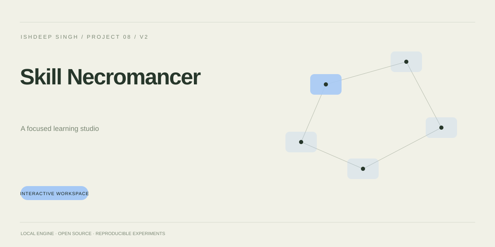

# Skill Necromancer

A narrow adaptive-practice tool that tracks concept estimates and checks Gaussian-elimination row operations exactly.

**Ishdeep Singh · MIT licence · Local portfolio release 2.0.0**



## The V2 workspace

A focused learning studio.

- Concept path and mastery estimates with one adaptive question
- Worked feedback, hints and one-word recall triggers
- Separate exact-arithmetic row-operation studio
- Editable matrix entries and attempt journal

BKT mastery is a model estimate, not proof of exam readiness or learning gains. Read the [interface guide](docs/UI_GUIDE.md).

## Implemented features

- Generated practice for signs, scaling and elimination
- Bayesian knowledge-tracing updates with slip/guess parameters
- Lowest-estimated-mastery question selection
- Exact rational-arithmetic row-operation validation
- Hints, recall triggers and attempt history

## Run locally

Use Python 3.12. This directory is the complete repository root; it does not depend on any sibling folder or parent launcher. The browser opens directly into this app.

```bash
python -m venv .venv
```

Windows PowerShell:

```powershell
.venv\Scripts\python.exe -m pip install -r requirements.txt
.venv\Scripts\python.exe app.py
```

macOS / Linux:

```bash
.venv/bin/python -m pip install -r requirements.txt
.venv/bin/python app.py
```

Open http://127.0.0.1:8765/. Alternatively, Windows users can run `START_WINDOWS.bat`. Use `python app.py --port 8766` if the default port is occupied. Initial package installation requires internet access; no API key or npm build is required. The tested runtime is Linux/Python 3.12; Windows instructions and Docker recipes are provided but their execution has not been verified here.

## Demo walkthrough

[Watch the captioned MP4](assets/demo.mp4) · [Captions](assets/demo.srt)

The walkthrough is an edited sequence of screenshots captured from the running app, with explanatory captions. It is not evidence of unimplemented features or real-world deployment.

## Verify and reproduce

```bash
python -m unittest discover -s tests -v
python scripts/evaluate_all.py
node scripts/check-js.mjs
node scripts/check-ui.mjs
```

Node is optional for the last syntax-check command. Tests run locally; a GitHub Actions workflow is included and will run after the repository is uploaded. No remote CI result is claimed before that happens.

## Results and limits

Read [recorded experiments](docs/EXPERIMENTS.md) and [the model/simulator card](docs/MODEL_CARD.md). The bundled evaluation is reproducible, and its evidence type is documented. A passing invariant test is different from a measured prediction score. Small synthetic results do not establish real-world effectiveness.

Small authored question generator, BKT estimates, exact row checks. No measured human learning gains or semester-sized item bank.

### Research extensions still outside the current implementation

- Validated misconception classification and spaced scheduling
- Consented student studies and delayed learning assessments

## Documentation

- [Full synopsis and original design scope](synopsis.md)
- [Architecture and source reading order](docs/ARCHITECTURE.md)
- [Data provenance and partitions](docs/DATA_CARD.md)
- [Model/simulator card](docs/MODEL_CARD.md)
- [Experiment protocol and measured results](docs/EXPERIMENTS.md)
- [Interview explanations and accurate résumé bullets](docs/INTERVIEW_NOTES.md)
- [Executable experiment notebook](notebooks/experiment.ipynb)
- [Data and asset terms](DATA_LICENSES.md)

## Local state and deployment

The API binds to loopback by default. SQLite state, imports and generated artifacts live in `runtime/`, which is excluded from Git. Reset restores demonstration state and retains run history. Long operations run in background threads with cooperative cancellation.

This service is intended for a local single-user workbench. Public multi-user hosting needs authentication, a production server, upload/resource isolation and appropriate backups. The Docker recipe does not provide those features automatically.

## Licence

The source is MIT-licensed. External packages and datasets retain their own terms. See [LICENSE](LICENSE) and [DATA_LICENSES.md](DATA_LICENSES.md).
